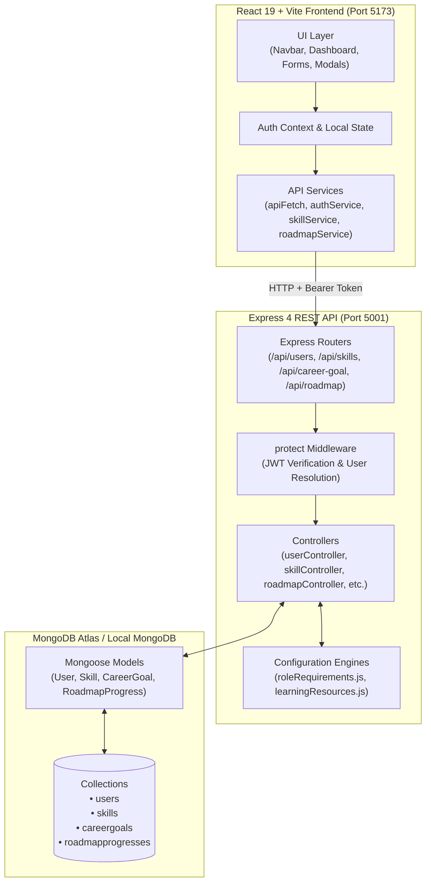

# SkillForge

**Personalized Developer Career Readiness, Skill Gap Analysis & Learning Roadmap Platform**

SkillForge is a full-stack career development workspace designed for students and aspiring software engineers. It enables users to evaluate their technical proficiencies, benchmark themselves against 13 industry engineering roles, analyze competency gaps through a transparent mathematical scoring model, and follow personalized learning roadmaps with curated documentation and hands-on portfolio projects.

---

## Table of Contents

- [1. Project Overview](#1-project-overview)
- [2. Key Features](#2-key-features)
- [3. Technology Stack](#3-technology-stack)
- [4. Application Architecture](#4-application-architecture)
- [5. Repository Structure](#5-repository-structure)
- [6. Installation & Local Setup](#6-installation--local-setup)
- [7. Environment Configuration](#7-environment-configuration)
- [8. API Documentation](#8-api-documentation)
- [9. Data Models](#9-data-models)
- [10. Career Skill-Gap & Readiness Analysis](#10-career-skill-gap--readiness-analysis)
- [11. Screenshots & User Workflow](#11-screenshots--user-workflow)
- [12. Testing & Quality Assurance](#12-testing--quality-assurance)
- [13. Security Considerations](#13-security-considerations)
- [14. Limitations & Future Roadmap](#14-limitations--future-roadmap)
- [15. Academic Project Details](#15-academic-project-details)

---

## 1. Project Overview

### The Problem
Computer science students and aspiring developers often struggle to identify the exact technical competencies demanded by competitive tech industries. Job descriptions are often vague, self-assessment lacks objective benchmarks, and generic tutorials fail to guide learners toward what they specifically lack. Learners need a deterministic, actionable roadmap that shows:
- What skills are required for their target role.
- How their current proficiency compares against industry expectations.
- Where their highest-impact gaps lie.
- What specific concepts to learn and what portfolio projects to build to bridge those gaps.

### The SkillForge Solution
SkillForge bridges the gap between academic learning and industry readiness:
1. **Skill Profiling:** Users record their verified skills on a standardized 1–5 continuous proficiency scale.
2. **Career Benchmarking:** Users select an engineering track from 13 supported industry roles.
3. **Deterministic Gap Spectrum:** An automated analyzer calculates exact proficiency deltas, assigns severity ratings (Critical, Moderate, Minor, Fulfilled), and computes an unpenalized, points-based readiness percentage.
4. **Actionable Roadmap & Milestone Tracking:** SkillForge generates targeted learning topics, authoritative documentation resources, and portfolio project suggestions, allowing users to track milestone completion with database persistence.

---

## 2. Key Features

### Authentication & Account Management
- **Secure Authentication:** User registration and login powered by salted password hashing (`bcryptjs`) and stateless JSON Web Tokens (`jsonwebtoken`).
- **Profile Header Dropdown:** Accessible navigation dropdown displaying user name, email, avatar initial, and sign-out controls; includes keyboard navigation and outside-click dismissal.
- **Strict Data Isolation:** Multi-tenant database design ensures that all skills, career goals, and roadmap progress records are strictly scoped to the authenticated user ID.

### Skills Management & 100+ Catalog
- **Individual Skill CRUD:** Add custom skills, edit proficiencies inline without leaving the dashboard, and remove skills.
- **Continuous 5-Tier Proficiency Scale:**
  - `Level 1`: Beginner (Basic syntax and concepts)
  - `Level 2`: Elementary (Simple scripts and guided usage)
  - `Level 3`: Intermediate (Autonomous feature implementation)
  - `Level 4`: Advanced (Production-grade architectural patterns)
  - `Level 5`: Expert (System optimization, internals, and mentoring)
- **100+ Curated Skill Library Modal:** Searchable modal with domain filtering (Frontend, Backend, Database, Cloud & DevOps, Data & AI, QA & Testing, Mobile, Fundamentals), batch selection, and custom entry.
- **Dashboard Search & Category Filters:** Real-time search input and category filter chips to search and inspect tracked competencies.
- **Recent Progress Timestamps:** Visual date badges (`🕒 Month Day, Year`) displaying when each competency was last updated.

### Career Goal Benchmarking (13 Supported Roles)
SkillForge supports 13 engineering tracks with realistic, role-specific benchmark proficiencies:
1. **Frontend Developer** (HTML, CSS, JavaScript, React, TypeScript, Git, Responsive Design, Web Performance)
2. **Backend Developer** (Node.js, Express, MongoDB, REST APIs, SQL, Docker, Microservices, Git)
3. **Full Stack Developer** (HTML, CSS, JavaScript, React, Node.js, Express, MongoDB, REST APIs, Git, System Architecture, Cloud Deployment)
4. **Data Analyst** (SQL, Python, Excel, Tableau, Statistics, Power BI, Pandas, Git)
5. **Machine Learning Engineer** (Python, Machine Learning, Deep Learning, TensorFlow, PyTorch, Scikit-Learn, SQL, Mathematics, Git)
6. **Java Developer** (Java, Spring Boot, REST APIs, SQL, Microservices, Git, Docker)
7. **Python Developer** (Python, Django / FastAPI, REST APIs, PostgreSQL, Git, Docker, SQL)
8. **DevOps Engineer** (Docker, Kubernetes, CI/CD Pipelines, Linux, AWS, Terraform, Git)
9. **Cloud Engineer** (AWS, Cloud Architecture, Docker, Kubernetes, Linux, Terraform, Networking)
10. **Cybersecurity Analyst** (Network Security, Linux, Cryptography, Vulnerability Assessment, Incident Response, Python)
11. **Data Engineer** (Python, SQL, PostgreSQL, Apache Spark, Data Pipelines, Docker, Git)
12. **QA / Test Automation Engineer** (Test Automation, Selenium, Cypress / Playwright, API Testing, JavaScript, Python, CI/CD Pipelines, Git)
13. **Mobile App Developer** (React Native, Flutter, Mobile UI/UX, REST APIs, JavaScript, TypeScript, Git)

### Career-Readiness Analyzer
- **Transparent Mathematical Scoring:** Displays exact points earned toward target benchmarks without penalizing non-role skills.
- **Severity Classification:** Classifies gaps into High-Impact/Critical ($\ge 3$ levels), Medium-Impact/Moderate ($2$ levels), Low-Impact/Minor ($1$ level), and Met ($0$ gap).
- **Highest-Impact Priority Chips:** Highlights the top 3 actionable skills to accelerate career readiness.
- **Contextual Feedback:** Supportive prompts for first-time users with 0 logged skills, and celebratory mastery notifications when 100% of benchmarks are satisfied.

### Personalized Learning Roadmap & Progress Tracking
- **Curated Learning Topics:** Recommends targeted focus areas for each pending gap.
- **Authoritative Resources:** Direct, safe links (`rel="noopener noreferrer"`) to official documentation (MDN, React Docs, Python Docs, AWS, Kubernetes, etc.).
- **Hands-on Project Ideas:** Practical portfolio projects designed to demonstrate applied mastery.
- **Persistent Milestone Checkboxes:** Users can mark milestones as complete or incomplete; completion state persists to MongoDB across sessions.
- **Live Completion Progress:** Displays visual progress bars and live completion statistics (`X of Y milestones completed`).

---

## 3. Technology Stack

### Frontend
| Technology | Version | Purpose in SkillForge |
| :--- | :--- | :--- |
| **React** | `^19.2.8` | Component-based client interface, hooks, and responsive rendering |
| **Vite** | `^8.2.2` | Rapid build tool, local dev server with Hot Module Replacement (HMR) |
| **Oxlint** | `^1.79.0` | High-performance JavaScript/React linter for clean code standards |
| **Vanilla CSS** | — | Custom design system, responsive layouts, navy gradients, micro-animations |

### Backend
| Technology | Version | Purpose in SkillForge |
| :--- | :--- | :--- |
| **Node.js** | `>=18.0.0` | Asynchronous runtime environment powering server execution |
| **Express** | `^4.21.2` | REST API routing, controller handling, and middleware integration |
| **MongoDB Atlas** | — | Cloud NoSQL database for document storage and indexing |
| **Mongoose** | `^9.10.3` | Object Data Modeling (ODM), schema validation, and compound indexes |
| **JSON Web Tokens** | `^9.0.3` | Cryptographic JWT token generation and verification for protected routes |
| **BcryptJS** | `^3.0.3` | Salted one-way password hashing (10 salt rounds) |
| **CORS** | `^2.8.5` | Cross-Origin Resource Sharing middleware for client-server communication |
| **Dotenv** | `^18.0.5` | Secure environment variable configuration |

---

## 4. Application Architecture

SkillForge uses a decoupled client-server architecture:
- The React client communicates with the Express REST API via asynchronous HTTP requests using a centralized fetch service (`apiFetch`).
- Authentication is handled statelessly via JWT tokens stored in browser `localStorage` and transmitted via standard HTTP `Authorization: Bearer <token>` headers.
- Protected API endpoints pass through an authentication middleware (`protect`) that validates token signatures and attaches the verified user model to `req.user`.
- MongoDB collections enforce multi-tenant isolation through schema constraints and compound unique indexes.

### Architecture Diagram



---

## 5. Repository Structure

```
SkillForge/
├── .env                       # Root environment variables (git-ignored)
├── .gitignore                  # Git ignore rules (node_modules, .env, dist)
├── README.md                   # Comprehensive project documentation
├── client/                     # Frontend React + Vite application
│   ├── index.html              # HTML5 entry point
│   ├── package.json            # Frontend dependencies and scripts
│   ├── vite.config.js          # Vite configuration with React plugin
│   └── src/
│       ├── main.jsx            # Application bootstrap & DOM root mount
│       ├── App.jsx             # Shell router & page view controller
│       ├── App.css             # Base application wrapper styles
│       ├── index.css           # Global typography, color tokens, and CSS resets
│       ├── assets/             # Static graphic assets (hero illustration)
│       ├── components/         # Reusable React components
│       │   ├── AuthBrandPanel.jsx       # Side branding panel for login/register
│       │   ├── CareerGoalSection.jsx    # Target role dropdown selector
│       │   ├── CareerReadinessCard.jsx  # Readiness percentage & calculation details
│       │   ├── DashboardPage.jsx        # Main authenticated career workspace
│       │   ├── LoginPage.jsx            # Sign-in form with validation
│       │   ├── Navbar.jsx               # Header with profile dropdown
│       │   ├── RegisterPage.jsx         # Registration form with validation
│       │   ├── RoadmapSection.jsx       # Personalized roadmap & progress toggles
│       │   ├── SkillForm.jsx            # Custom skill addition form
│       │   ├── SkillGapSection.jsx      # Gap spectrum cards & severity badges
│       │   ├── SkillItem.jsx            # Individual skill card with inline edit
│       │   └── SkillSelectionModal.jsx  # 100+ skill catalog multi-selector
│       ├── config/
│       │   └── skillCatalog.js          # Categorized skill catalog definitions
│       ├── context/
│       │   ├── AuthContext.jsx          # User session & token state provider
│       │   ├── authContextInstance.js   # React Context instance
│       │   └── useAuth.js               # Custom hook for authentication context
│       ├── services/
│       │   ├── api.js                   # Universal fetch wrapper with token injection
│       │   ├── authService.js           # Auth & profile API requests
│       │   ├── careerGoalService.js     # Career goal API & metadata
│       │   ├── roadmapService.js        # Roadmap & milestone progress API
│       │   └── skillService.js          # Skills CRUD, batch, & gap API
│       └── styles/
│           ├── auth.css                 # Auth & navigation bar styles
│           ├── dashboard.css            # Dashboard layout, cards, and animations
│           ├── milestone14c.css         # Gap & roadmap layout styles
│           └── skills.css               # Skills management styles
└── server/                     # Backend Node.js + Express API
    ├── package.json            # Server dependencies and scripts
    └── src/
        ├── index.js            # Server entry point & database initialization
        ├── app.js              # Express app middleware & route mounting
        ├── config/
        │   ├── db.js                    # MongoDB Mongoose connection handler
        │   ├── learningResources.js     # Skill-to-topic/resource/project dictionary
        │   └── roleRequirements.js     # 13 role definitions & benchmark levels
        ├── controllers/
        │   ├── careerGoalController.js  # Career goal GET and PUT handlers
        │   ├── healthController.js      # Health check endpoint handler
        │   ├── roadmapController.js     # Roadmap generator & progress persistence
        │   ├── skillController.js       # Skills CRUD, batching, and gap engine
        │   └── userController.js        # Registration, login, & profile handlers
        ├── middleware/
        │   └── authMiddleware.js        # JWT verification & req.user attachment
        ├── models/
        │   ├── careerGoal.model.js      # Mongoose schema for user target role
        │   ├── roadmapProgress.model.js # Mongoose schema for milestone completion
        │   ├── skill.model.js           # Mongoose schema for user skills
        │   └── user.model.js            # Mongoose schema for user accounts
        └── routes/
            ├── careerGoalRoutes.js      # /api/career-goal route definitions
            ├── healthRoutes.js          # /api/health route definitions
            ├── roadmapRoutes.js         # /api/roadmap route definitions
            ├── skillRoutes.js           # /api/skills route definitions
            └── userRoutes.js            # /api/users route definitions
```

---

## 6. Installation & Local Setup

### Prerequisites
- **Node.js**: v18.0.0 or higher ([Download Node.js](https://nodejs.org/))
- **npm**: v9.0.0 or higher
- **MongoDB**: A running local MongoDB instance (`mongodb://127.0.0.1:27017/skillforge`) or a free [MongoDB Atlas](https://www.mongodb.com/atlas) cluster URI.

### Step 1: Clone the Repository
```bash
git clone https://github.com/Astik-493/SkillForge.git
cd SkillForge
```

### Step 2: Configure the Backend Environment
Navigate to the `server/` directory and create a `.env` file:
```bash
cd server
touch .env
```
Add the required environment variables:
```env
PORT=5001
MONGODB_URL=your_mongodb_connection_string
JWT_SECRET=your_jwt_secret_key
```

### Step 3: Install Backend Dependencies & Start Server
```bash
# Inside the server directory
npm install

# Start in development mode (with Node --watch)
npm run dev
```
The server will connect to MongoDB and listen on `http://localhost:5001`.

### Step 4: Install Frontend Dependencies & Start Client
Open a second terminal window and navigate to the `client/` directory:
```bash
cd client
npm install

# Start Vite development server
npm run dev
```
The client will start and display a local URL (typically `http://localhost:5173`).

### Step 5: Access the Application
Open your browser and navigate to:
```
http://localhost:5173
```
Create a new account on the registration page or sign in to access the dashboard.

---

## 7. Environment Configuration

The backend reads configuration settings using `dotenv`. Create `server/.env` with the following variables:

```env
# Port on which the Express server listens (default: 5001)
PORT=5001

# MongoDB Connection String (MongoDB Atlas or local instance)
MONGODB_URL=mongodb+srv://<username>:<password>@<cluster>.mongodb.net/skillforge?retryWrites=true&w=majority

# Secret key used for signing and verifying JSON Web Tokens
JWT_SECRET=replace_with_a_long_random_cryptographic_secret
```

> **Security Notice:** The `server/.env` file contains sensitive database credentials and JWT signing keys. It is listed in `.gitignore` and must **never** be committed to version control.

---

## 8. API Documentation

All API endpoints are prefixed with `/api`. Protected routes require a valid JWT token sent in the `Authorization` header using the Bearer scheme:
```
Authorization: Bearer <your_jwt_token>
```

### 1. Health & Diagnostics
| Method | Endpoint | Access | Description | Request Body |
| :--- | :--- | :--- | :--- | :--- |
| `GET` | `/api/health` | Public | Server uptime and health status check | None |

### 2. User Authentication & Profile
| Method | Endpoint | Access | Description | Request Body |
| :--- | :--- | :--- | :--- | :--- |
| `POST` | `/api/users/register` | Public | Register new user account | `{ "name": "string", "email": "string", "password": "string" }` |
| `POST` | `/api/users/login` | Public | Authenticate user and issue JWT token | `{ "email": "string", "password": "string" }` |
| `GET` | `/api/users/profile` | Protected | Retrieve authenticated user profile | None |

### 3. Skills Management
| Method | Endpoint | Access | Description | Request Body |
| :--- | :--- | :--- | :--- | :--- |
| `GET` | `/api/skills` | Protected | Fetch all skills for authenticated user | None |
| `POST` | `/api/skills` | Protected | Add single skill | `{ "name": "string", "proficiency": 1-5 }` |
| `POST` | `/api/skills/batch` | Protected | Batch add or update multiple skills | `{ "skills": [{ "name": "string", "proficiency": 1-5 }] }` |
| `PATCH` | `/api/skills/:id` | Protected | Update skill name or proficiency | `{ "name"?: "string", "proficiency"?: 1-5 }` |
| `DELETE` | `/api/skills/:id` | Protected | Delete skill by ID | None |
| `GET` | `/api/skills/gaps` | Protected | Calculate gaps against active target role | None |

### 4. Career Goal
| Method | Endpoint | Access | Description | Request Body |
| :--- | :--- | :--- | :--- | :--- |
| `GET` | `/api/career-goal` | Protected | Get authenticated user's target role | None |
| `PUT` | `/api/career-goal` | Protected | Set or update active target career role | `{ "targetRole": "Frontend Developer" }` |

### 5. Personalized Learning Roadmap & Progress
| Method | Endpoint | Access | Description | Request Body |
| :--- | :--- | :--- | :--- | :--- |
| `GET` | `/api/roadmap` | Protected | Generate roadmap milestones & recommendations | None |
| `GET` | `/api/roadmap/progress` | Protected | Fetch milestone completion records for active role | None |
| `PUT` | `/api/roadmap/progress` | Protected | Toggle completion status of a milestone | `{ "skill": "React", "completed": true }` |

---

## 9. Data Models

All models are defined using Mongoose schemas and stored in MongoDB.

### 1. User Model (`User`)
- `name` *(String, required, trimmed)*: Full name of the user.
- `email` *(String, required, unique, lowercase, trimmed)*: User login email.
- `password` *(String, required)*: Salted one-way hash generated with `bcryptjs`.
- `timestamps`: Automatically manages `createdAt` and `updatedAt`.

### 2. Skill Model (`Skill`)
- `user` *(ObjectId, ref: 'User', required)*: Scopes the skill to the owner user.
- `name` *(String, required, trimmed)*: Name of the competency (e.g., `React`, `Docker`).
- `proficiency` *(Number, required, min: 1, max: 5)*: Discrete proficiency level.
- `indexes`: Compound unique index `{ user: 1, name: 1 }` prevents duplicate skills per user.
- `timestamps`: Automatically manages `createdAt` and `updatedAt`.

### 3. Career Goal Model (`CareerGoal`)
- `user` *(ObjectId, ref: 'User', required, unique)*: Ensures one active goal per user.
- `targetRole` *(String, required, enum)*: Must match one of the 13 supported roles in `SUPPORTED_ROLES`.
- `timestamps`: Automatically manages `createdAt` and `updatedAt`.

### 4. Roadmap Progress Model (`RoadmapProgress`)
- `user` *(ObjectId, ref: 'User', required)*: Owner user reference.
- `targetRole` *(String, required, trimmed)*: Role context for the milestone.
- `skill` *(String, required, trimmed)*: Name of the skill milestone being tracked.
- `completed` *(Boolean, default: false)*: Milestone completion flag.
- `completedAt` *(Date, default: null)*: Timestamp when the milestone was completed.
- `indexes`: Compound unique index `{ user: 1, targetRole: 1, skill: 1 }` ensures accurate per-milestone persistence.
- `timestamps`: Automatically manages `createdAt` and `updatedAt`.

---

## 10. Career Skill-Gap & Readiness Analysis

### Calculation Engine
SkillForge uses a non-punitive, points-based scoring engine to calculate career readiness:

$$\text{Readiness \%} = \mathrm{round}\left(\frac{\sum \min(\text{currentProficiency}, \text{requiredProficiency})}{\sum \text{requiredProficiency}} \times 100\right)$$

#### Principles
1. **Continuous Spectrum:** Proficiencies are evaluated from level 1 through 5, recognizing partial progress rather than treating skills as binary pass/fail.
2. **Exact Delta:** The gap is calculated as:
   $$\text{gap} = \max(0, \text{requiredProficiency} - \text{currentProficiency})$$
3. **No Penalty for Additional Skills:** Competencies logged by the user that are outside the target role's requirements remain in their profile and do not reduce the readiness score.
4. **Severity Tiers:**
   - **Critical / High Impact ($\text{gap} \ge 3$):** Skill is completely missing or significantly below the required benchmark.
   - **Moderate / Medium Impact ($\text{gap} = 2$):** Partial proficiency established; targeted project work needed.
   - **Minor / Low Impact ($\text{gap} = 1$):** Close to benchmark; refinement and advanced pattern review needed.
   - **Met / Fulfilled ($\text{gap} = 0$):** Current proficiency satisfies or exceeds the benchmark.

### Concrete Example
Assume the user selects **Frontend Developer** with benchmark requirements:
- `HTML`: Target Level 4
- `CSS`: Target Level 4
- `JavaScript`: Target Level 4
- `React`: Target Level 4
- `TypeScript`: Target Level 3
- `Git`: Target Level 3
- `Responsive Design`: Target Level 4
- `Web Performance`: Target Level 3  
**Total Target Points:** $4 + 4 + 4 + 4 + 3 + 3 + 4 + 3 = 29\text{ points}$

If the user's verified skills profile contains:
- `HTML`: Level 4 (Earned: 4) &rarr; Gap = 0 (Met)
- `CSS`: Level 3 (Earned: 3) &rarr; Gap = 1 (Minor)
- `JavaScript`: Level 4 (Earned: 4) &rarr; Gap = 0 (Met)
- `React`: Level 2 (Earned: 2) &rarr; Gap = 2 (Moderate)
- `Git`: Level 3 (Earned: 3) &rarr; Gap = 0 (Met)
- `Docker`: Level 4 (Additional skill outside Frontend role &rarr; preserved, no penalty)  
**Total Earned Points:** $4 + 3 + 4 + 2 + 0 (\text{TypeScript}) + 3 + 0 (\text{Responsive}) + 0 (\text{Web Perf}) = 16\text{ points}$

$$\text{Readiness Score} = \mathrm{round}\left(\frac{16}{29} \times 100\right) = 55\%$$

---

## 11. Screenshots & User Workflow

> **Note:** Screenshots can be captured and added to the `docs/screenshots/` directory.

| View | Description | Suggested Screenshot Path |
| :--- | :--- | :--- |
| **Authentication** | Dual-panel login and registration interface | `docs/screenshots/01-auth-login.png` |
| **Dashboard Workspace** | Welcome banner, quick actions, and career card | `docs/screenshots/02-dashboard-overview.png` |
| **Readiness Card** | Score progress bar, formula details, and severity stats | `docs/screenshots/03-career-readiness.png` |
| **100+ Skill Library** | Searchable multi-selection modal by domain | `docs/screenshots/04-skill-catalog-modal.png` |
| **Skill Gap Spectrum** | Gap cards with segment meters and recommendations | `docs/screenshots/05-skill-gaps.png` |
| **Learning Roadmap** | Resource links, project ideas, and progress checkboxes | `docs/screenshots/06-roadmap-milestones.png` |

### Typical User Workflow
1. **Account Registration:** User registers an account with their name, email, and password.
2. **Target Role Selection:** From the dashboard, the user chooses their desired career track (e.g., `DevOps Engineer` or `Mobile App Developer`).
3. **Skill Profiling:** User adds known skills via the inline form or selects them in bulk from the 100+ Skill Catalog Modal.
4. **Readiness Evaluation:** The dashboard computes the user's readiness score, displays gap severity badges, and highlights top-priority focus areas.
5. **Roadmap Execution:** User opens the personalized roadmap to review curated documentation and build hands-on project ideas.
6. **Milestone Tracking:** As competencies improve, the user marks roadmap milestones as completed and updates skill proficiencies inline to watch their readiness score approach 100%.

---

## 12. Testing & Quality Assurance

SkillForge maintains strict code quality standards with both automated linter checks and end-to-end integration test suites:

### 1. Frontend Linting (`oxlint`)
Run the frontend linter to verify syntax, React hooks rules, and code standards:
```bash
cd client
npm run lint
```
*Result: 0 errors, 0 warnings across 25 files.*

### 2. Frontend Production Build (`vite build`)
Validate TypeScript/JSX compilation and asset bundling:
```bash
cd client
npm run build
```
*Result: Clean production bundle compiled in ~70ms.*

### 3. Automated End-to-End Integration Suite
The test suite validates:
- Registration, duplicate rejection, and credential verification.
- Multi-tenant user isolation.
- Validation of all 13 supported roles against gap and roadmap engines.
- Formula correctness for readiness percentages and gap severities.
- Non-role skill immunity.
- Roadmap milestone progress persistence (`PUT /api/roadmap/progress`).
- Inline skill CRUD operations and timestamp updates.

Run the test suite:
```bash
node scratch/test_milestone_18_full_e2e.js
```
*Result: 7/7 test suites passing.*

---

## 13. Security Considerations

- **Password Hashing:** Passwords are never stored in plaintext. They are hashed using `bcryptjs` with 10 salt rounds prior to saving to MongoDB.
- **JWT Protection:** Protected endpoints require an `Authorization: Bearer <token>` header verified by `jwt.verify()` using a server-side secret key.
- **Sensitive Data Exclusion:** Mongoose queries exclude password hashes (`.select('-password')`) so sensitive hashes are never transmitted in API responses.
- **User Scoping & Isolation:** All skill, career goal, and roadmap database queries explicitly filter by `user: req.user._id`, preventing unauthorized cross-user access or manipulation.
- **Safe Regex Escaping:** User inputs used in regular expressions (e.g. duplicate skill checks) are sanitized to prevent Regular Expression Denial of Service (ReDoS).
- **Environment Protection:** Database URIs and JWT secrets are kept in `.env` files that are ignored by Git.

---

## 14. Limitations & Future Roadmap

### Current Limitations
- **Local Client-Server Setup:** The project is configured for local development (`localhost:5173` client and `localhost:5001` backend).
- **Curated Resource Library:** Learning resources and project recommendations are maintained in centralized dictionary configurations rather than fetched dynamically from third-party course APIs.
- **No Third-Party OAuth:** Authentication uses standard email/password credentials; social logins (e.g., GitHub, Google OAuth) are not yet integrated.

### Future Roadmap
- **Resume / CV Parsing:** Automated extraction of skills from PDF resumes using OCR and NLP.
- **Third-Party Course APIs:** Integration with platforms like Coursera, edX, or YouTube Data API for dynamic video tutorial suggestions.
- **Automated Skill Assessments:** In-platform quizzes and coding challenges to verify skill proficiency objectively.
- **Peer & Industry Benchmarking:** Anonymous percentile comparison showing how a student's readiness compares with peers aiming for the same role.

---

## 15. Academic Project Details

- **Project Title:** SkillForge: Developer Career Readiness & Skill Gap Engine
- **Student Name:** Astik
- **Repository:** [https://github.com/Astik-493/SkillForge](https://github.com/Astik-493/SkillForge)
- **Course / Degree:** Computer Science & Engineering
- **Submission Purpose:** Academic Capstone / End-Term Project Submission
- **Year / Semester:** Academic Year 2026

---

*SkillForge &copy; 2026. Built with React, Vite, Node.js, Express, and MongoDB.*